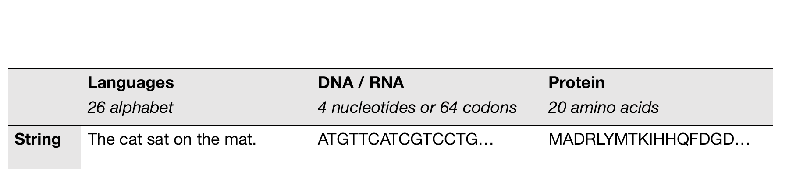
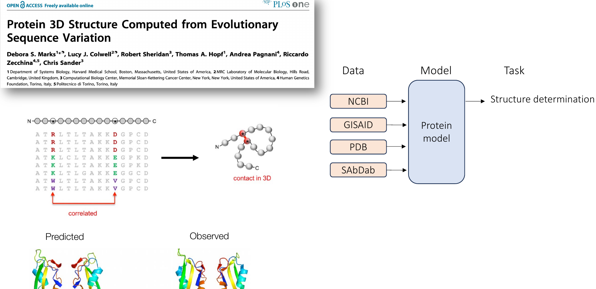
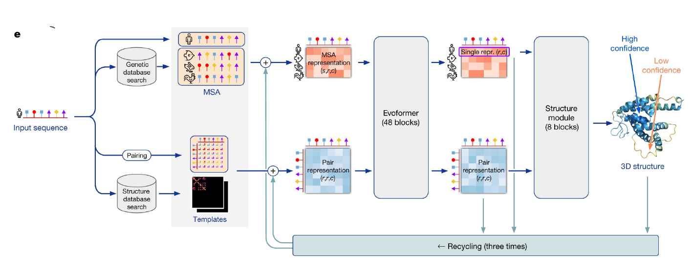

% Protein Language Models for AI4Health
% AI for Health
% March 24, 2026

# Module arc

- sequence as language
- representation models
- structure prediction
- generative design
- AI-for-health applications

Core question:

- what do protein foundation models learn, and how can we use them in health?

::: notes
The metadata already generates the title slide.
:::

# Why this module matters

- Proteins sit between genotype and phenotype.
- Sequence data is abundant; structural and functional labels are much scarcer.
- Protein language models let us learn from raw sequence scale before task-specific supervision.
- In AI for health, that matters for variant interpretation, therapeutic design, and target biology.

::: notes
This slide sets the foundation-model framing for the rest of the lecture.
:::

# Proteins as a language

{width=80%}

::: notes
Visual adapted from Sarah Gurev, MLCB 2024, using the user's local Lecture 11 deck.
:::

# What the language analogy gives us

- Amino-acid sequences have local syntax, long-range dependencies, and biological meaning.
- "Meaning" in protein space includes fold, stability, binding, localization, and function.

::: notes
This verbal follow-up slide prevents the image slide from becoming overcrowded in the export.
:::

# The foundation-model view of proteins

{width=78%}

::: notes
Layout adapted from Madani et al. via Sarah Gurev, MLCB 2024.
This figure frames pLMs as a bridge between data scale and biomedical tasks.
:::

# Why this framing matters

- Data: sequence repositories, structures, antibodies, and interaction datasets
- Model: a protein foundation model
- Tasks: structure, mutation effects, interactions, and design

::: notes
This slide makes the analogy to NLP explicit and also shows why protein ML is broader than structure prediction.
:::

# What protein language models learn

- Local biochemical regularities
- Remote residue dependencies
- Evolutionary constraints
- Signals related to structure and mutation effects

Rough mental model:

- `representation` models embed protein sequences
- `prediction` models infer structure or function
- `generation` models design new sequences or structures

::: notes
Key citation: Rives et al., 2021.
Use this slide to distinguish model families early.
:::

# A practical taxonomy

| Family | Canonical examples | What goes in | What comes out |
|---|---|---|---|
| Representation | `ProtTrans`, `ESM-1/2` | sequence | embeddings, scores |
| Structure prediction | `AlphaFold2`, `ESMFold`, `AlphaFold3` | sequence, MSA, templates, or single sequence | 3D structure and confidence |
| Generation | `ProtGPT2`, `ProteinMPNN`, `RFdiffusion`, `ESM3` | sequence, structure, prompts | new sequences, structures, functions |

::: notes
Keep students from lumping all protein models together.
:::

# How these models are used in practice

- Pretrain once on large unlabeled protein corpora
- Reuse embeddings for downstream tasks
- Fine-tune only when the task or dataset justifies it
- Pair language models with structure models and wet-lab validation

Teaching message:

- Universities usually use pretrained models far more often than they train them from scratch.

*Teaching framing adapted from Galaxy Training Network protein language model materials (CC BY 4.0).*

::: notes
Online teaching source: Galaxy GTN "Fine-tuning the Protein Language Model".
:::

# ProtTrans and the scale story

- `ProtTrans` is a good first example of protein transfer learning at scale.
- ORNL reports training on up to `393 billion amino acids`.
- Reported compute included `5616 GPUs` and up to `1024 TPU cores`.

Takeaway:

- The main classroom lesson is not the exact number.
- It is that large protein corpora support reusable biological representations.

::: notes
Primary source: ORNL ProtTrans page.
:::

# ESM and zero-shot mutation effects

- `ESM` models are core sequence representation models.
- They show that structure- and function-related information can emerge from sequence-only pretraining.
- Protein language models can also support `zero-shot` mutation-effect prediction.

Health connection:

- This is one of the clearest paths from pLMs to disease-variant interpretation.

::: notes
Key sources: Rives et al., 2021 and Meier et al., NeurIPS 2021.
:::

# Structure from language: ESMFold

- `ESMFold` predicts structure from a single sequence using protein LM representations.
- It avoids the full `MSA + template` pipeline used by AlphaFold2.
- This makes it the cleanest bridge from pLMs to structure prediction.

Classroom framing:

- `AlphaFold2` changed structure prediction.
- `ESMFold` showed how far single-sequence language models had progressed.

::: notes
Reference summary from Hugging Face ESM docs and the ESMFold paper summary.
:::

# AlphaFold2 remains the comparison point

{width=82%}

::: notes
Workflow figure adapted from the user's local Lecture 09/10 deck, originally citing Jumper et al., Nature 2021.
:::

# What to remember about AlphaFold2

- Input sequence plus `MSA` and optional templates
- `Evoformer` updates sequence and pair representations
- Structure module predicts 3D coordinates and confidence

::: notes
Keeping the bullets on a separate slide avoids awkward content splitting in the PPTX export.
:::

# AlphaFold2, ESMFold, and AlphaFold3

- `AlphaFold2`
  strongest historical reference point; relies heavily on MSA information
- `ESMFold`
  single-sequence structure prediction powered by protein language model representations
- `AlphaFold3`
  extends the task to broader biomolecular interactions involving proteins, nucleic acids, and ligands

Teaching rule:

- Present AlphaFold inside this module as a partner and comparison model, not as a generic protein LM.

::: notes
Sources: AlphaFold 2021 and AlphaFold 3 papers.
:::

# Reading structure predictions responsibly

- Confidence matters:
  `pLDDT` and `PAE` are not optional extras
- High structural confidence is not the same as validated function
- Disorder, complexes, ligands, and alternate conformations remain hard cases

Three warnings for students:

- pretty structure is not proof
- monomer structure is not the whole biology
- experimental validation still decides utility

*Pedagogical framing adapted from EMBL-EBI AlphaFold course slides (CC BY 4.0).*

::: notes
Online source: EMBL-EBI AlphaFold course slides.
:::

# From prediction to design

- Once we can model protein space, we naturally ask whether we can also generate new proteins.
- This splits into three design settings:
  sequence generation,
  inverse folding,
  and structure generation.

Use this as the transition slide before generative models.

::: notes
This slide is a section divider.
:::

# Sequence generation: ProtGPT2

- Autoregressive model for de novo protein sequence generation
- Useful to introduce the idea of "writing" protein sequences directly
- The paper reports that `88%` of generated sequences were predicted as globular

Main teaching point:

- Natural-looking sequence is an encouraging signal, but not the same as function

::: notes
Primary source: ProtGPT2, Nature Communications 2022.
:::

# Structure-conditioned design: ProteinMPNN

- Input: backbone structure
- Output: a sequence expected to realize that structure
- This is inverse folding rather than generic language modeling

Why it matters:

- It is a standard step in modern protein design pipelines
- It connects structure generation to actual sequence design

::: notes
Primary source: ProteinMPNN, Science 2022.
:::

# Structure generation: RFdiffusion

- Diffusion model for generating protein backbones
- Strong for motif scaffolding, binder design, and de novo structural design
- Often paired with `ProteinMPNN` after backbone generation

Takeaway:

- This is one of the most important modern design workflows for students to recognize

::: notes
Primary source: RFdiffusion, Nature 2023.
:::

# Multimodal generation: ESM3

- `ESM3` moves beyond sequence-only modeling
- Jointly reasons over `sequence`, `structure`, and `function`
- A good capstone example because it unifies representation learning and generation

Frontier message:

- Protein foundation models are moving toward multimodal, prompted biological generation

::: notes
Primary sources: EvolutionaryScale repository and Hayes et al., Science 2025.
:::

# AI-for-health applications

- Missense variant interpretation
- Antibody and binder design
- Vaccine and antigen design
- Enzyme engineering for diagnostics and therapeutics
- Structure-guided target understanding

Balanced conclusion:

- These models accelerate hypothesis generation
- They do not replace biological experiments or clinical evidence

::: notes
You can tie this slide back to examples in the user's local Lecture 11 deck on mutation effects and vaccine design.
:::

# Limitations, evaluation, and safety

- Training-data overlap and benchmark leakage are real risks
- Generated proteins may be plausible but unstable, nonfunctional, or unexpressed
- Dual-use concerns apply to open generative models
- Evaluation should combine novelty, structure, assay performance, and biological relevance

If students remember one sentence:

- `structure confidence is useful, but function is the real endpoint`

::: notes
This slide is important for keeping the module grounded.
:::

# Take-home messages

- Protein language models learn meaningful biological representations from sequence alone
- `AlphaFold2`, `ESMFold`, and `AlphaFold3` belong in this module because they anchor the prediction side of the field
- Generative models now span sequence, inverse folding, and diffusion-based structure design
- The field is moving toward multimodal protein foundation models
- In health applications, model output is a starting point, not the final answer

## Suggested reading

- `Rives et al., 2021`
- `Jumper et al., 2021`
- `Abramson et al., 2024`
- `ProtGPT2, 2022`
- `RFdiffusion, 2023`
- `Hayes et al., 2025`

::: notes
End on distinctions, not just a model list: represent, predict, generate, validate.
:::
